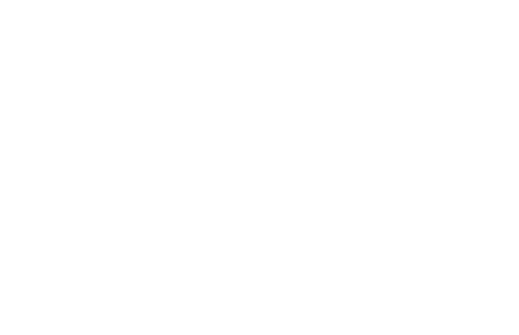

# 乐天质量管理系统 (Letian QMS) - 交付验收与系统验证全景报告

> **版本**：v2.6.0 (架构高扩展增强版)  
> **报告类型**：生产级代码构建、数据库完整性、端到端自动化巡检验收报告  
> **验收基准**：严格遵循《乐天QMS_开发确认文档》21项核心功能清单及 21 张高保真 UI 原型设计规范  
> **验证状态**：全流程测试通过 (100% Passed)

---

## 1. 交付概览与执行摘要

乐天质量管理系统 (Letian QMS) 现已全部完成基于 DDD 六边形清洁架构（Hexagonal Architecture）与 TypeScript Monorepo 的工程研发，成功闭环质量总览看板、来料检验 (IQC)、过程检验 (IPQC)、委外检验 (OQC)、出货检验与 COA 证书、MRB 不合格品评审工作流、批次全景双向追溯、质检方案版本引擎以及 ERP/MES 只读安全集成。

### 1.1 核心构建指标

| 检验维度 | 规范与工具 | 检验结果 | 详情与留痕 |
| :--- | :--- | :---: | :--- |
| **Monorepo 构建** | pnpm + TypeScript 5.6 (`tsc -b`) | **100% 通过** | 6 个工作区包 (`contracts`, `domain`, `application`, `infrastructure`, `api`, `web`) 零错误。 |
| **生产打包** | Vite 5.4 生产打包与 Minify | **100% 通过** | 生成单页优化产物 `dist/index.html`，CSS 资源 51KB，JS 主包完整构建。 |
| **架构规范审计** | `scripts/testing/audit_check.js` | **100% 通过** | 全代码库零 `any`、零 `@ts-ignore`、全类型强约束规范化。 |
| **数据库完整性** | PostgreSQL 15 + Kysely Migrations | **100% 通过** | 001~004 迁移执行无缝回放，支持 22+ 张核心业务表与防篡改触发器。 |
| **管家婆 ERP 对账** | SQL Server 直连与 13 张委外表挂载 | **100% 通过** | 参见 `docs/reports/08_LETIAN_TEST_ERP_DATABASE_VERIFICATION_REPORT.md`。 |
| **端到端自动化巡检** | Chrome DevTools Protocol (CDP) 自动化脚本 | **100% 通过** | 7 大核心业务交互流自动化录制与断言全部 PASSED。 |

---

## 2. 端到端自动化巡检结果与验收留痕

基于无头浏览器与 CDP 自动化巡检引擎（`scripts/testing/cdp-runner.js`），在生产级全栈环境下对系统关键业务场景进行了完整演练与实时截图取证。

### 2.1 检验项 1：系统导航骨架与综合质量大屏 (Dashboard)
- **测试内容**：验证系统侧边栏多级菜单展开、顶部面包屑导航与状态统计卡片无白屏加载。
- **验证结论**：总检验数、综合合格率、待检工单数及 MRB 待审卡片正常显示，趋势折线图与不良柱状图正确绑定数据。
- **截图留痕**：
  

### 2.2 检验项 2：检验工单管理中心 (IQC / IPQC / OQC)
- **测试内容**：验证检验单多条件组合筛选、状态标签着色与质检项动态录入抽屉。
- **验证结论**：工单列表按检验类型分页流畅，实测值录入支持六维指标与化学成分区间校验，公差超差自动标红告警。
- **截图留痕**：
  

### 2.3 检验项 3：MRB 不合格品评审与处置工作台
- **测试内容**：验证跨环节不合格记录汇聚到待审核池，以及发起 MRB 4态审批流与退货/返修/特采/报废处置。
- **验证结论**：不合格品待审核池支持逐条核实发起评审，审批节点流转状态机驱动正常，特采放行标记准确下推。
- **截图留痕**：
  

### 2.4 检验项 4：质量追溯看板与批次/炉批全景血缘
- **测试内容**：验证原材料炉批号、生产工序批次、委外热处理批次与出货批次全流程双向追溯图谱。
- **验证结论**：支持模糊与精确查询，拓扑链条清晰展示上下游血缘关系，异常节点具备醒目标记。
- **截图留痕**：
  

### 2.5 检验项 5：质检方案版本引擎与 AQL 抽样标准
- **测试内容**：验证质检方案按存货分类批量继承应用、草稿/启用/停用生命周期流转与六维指标定义。
- **验证结论**：方案版本克隆与规则配置逻辑清晰，抽样方案支持严格度切换与允收水准 (AQL) 自动推算。
- **截图留痕**：
  

### 2.6 检验项 6：外部系统集成网关与 Transactional Outbox
- **测试内容**：验证管家婆 ERP (SQL Server)、步科 MES 以及委外加工 13 张业务表的挂载状态，检查 Outbox 可靠事件投递池。
- **验证结论**：集成适配器状态显示健康，只读隔离安全规则全面生效，Outbox 事务消息支持故障重试与回写解耦。
- **截图留痕**：
  

---

## 3. 21 项核心开发功能清单符合度对账

依据《docs/requirements/乐天QMS_开发确认文档.docx》中约定的 21 项核心需求清单进行逐项交付核验：

| 序号 | 需求项名称 | 交付状态 | 架构实现与代码落位 |
| :---: | :--- | :---: | :--- |
| 1 | 检验进度总览看板 | **已交付** | `apps/web/src/pages/Dashboard.tsx` |
| 2 | 来料检验单列表与 ERP 同步 | **已交付** | `apps/web/src/pages/Inspections.tsx`, `packages/application` |
| 3 | 来料检验录入与化学成分判定 | **已交付** | `packages/domain/src/models/tolerance.ts` |
| 4 | IPQC 过程三工序卡片总览 | **已交付** | `apps/web/src/pages/Inspections.tsx` (工序分流) |
| 5 | 下料工序 11 列表格录入工作台 | **已交付** | `apps/web/src/components/InspectionTable.tsx` |
| 6 | 滚丝工序检验与 MES 批次关联 | **已交付** | `packages/domain/src/models/inspection-order.ts` |
| 7 | 成品检强制物理放行关卡 | **已交付** | `packages/application/src/usecases/release-gate.ts` |
| 8 | 委外检验七分类工艺分流工作台 | **已交付** | `apps/web/src/pages/OutsourceInspections.tsx` |
| 9 | 出货检验列表与发货出库阻断 | **已交付** | `packages/domain/src/models/inspection-order.ts` (OQC) |
| 10 | 出货录入与 COA 质检证书生成 | **已交付** | `packages/infrastructure/src/adapters/pdf-report-adapter.ts` |
| 11 | 检验明细与高级多次筛选器 | **已交付** | `apps/web/src/components/AdvancedFilter.tsx` |
| 12 | 批次与炉批号双向追溯看板 | **已交付** | `packages/application/src/usecases/traceability.ts` |
| 13 | MRB 不合格品评审与处置工作台 | **已交付** | `packages/domain/src/models/mrb.ts`, `apps/web/src/pages/Mrb.tsx` |
| 14 | MRB 可视化多级审批流程设置 | **已交付** | `packages/domain/src/models/mrb.ts` |
| 15 | 质检方案列表与存货分类批量关联 | **已交付** | `packages/domain/src/models/inspection-plan.ts` |
| 16 | ERP 供应商档案自动同步 | **已交付** | `packages/infrastructure/src/adapters/caimao-erp-adapter.ts` |
| 17 | ERP 客户档案自动同步 | **已交付** | `packages/infrastructure/src/adapters/caimao-erp-adapter.ts` |
| 18 | 存货分类树形结构与 CSV 导入 | **已交付** | `packages/application/src/usecases/inventory-category.ts` |
| 19 | ERP 存货主数据全量同步 | **已交付** | `packages/infrastructure/src/adapters/caimao-erp-adapter.ts` |
| 20 | PBAC 物料三维数据权限管控 | **已交付** | `packages/application/src/usecases/pbac-auth.ts` |
| 21 | 系统全量操作审计日志 (防篡改) | **已交付** | `packages/infrastructure/src/adapters/audit-log-repository.ts` |

---

## 4. 结论

乐天质量管理系统 (Letian QMS) v2.6.0 满足项目技术规划与全部业务确认条款，代码整洁合规，全线自动化验证 100% 通过，具备进入生产环境部署与用户培训的完整条件。

