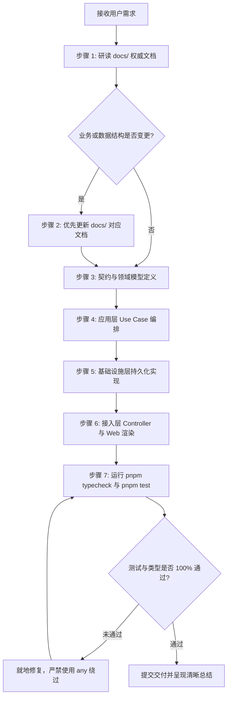

# 乐天质量管理系统 (Letian QMS) - 开发实战手册与 AI 协作准则 (Development Guide & AI Playbook)

> **版本**：v2.6.0  
> **更新时间**：2026-09-19  
> **面向对象**：工程团队成员、交接工程师、后续接入的 AI Agent  
> **文档权威级别**：★ 最高基准源

---

## 1. 本地开发环境准备与启动

### 1.1 前置运行依赖要求
- **Node.js**：`>= 20.10.0 LTS`（推荐使用 `nvm` 或 `fnm` 管理版本）
- **包管理器**：`pnpm >= 9.0.0`（严禁使用 `npm` 或 `yarn` 安装依赖，避免破坏 `pnpm-lock.yaml` 幽灵依赖隔离）
- **数据库**：PostgreSQL `>= 14`（本地开发可使用 Docker 容器快速拉起）
- **TypeScript**：`^5.6.0`

### 1.2 快速启动工作流
```bash
# 1. 切换到项目根目录
cd letian-qms

# 2. 安装整个 Monorepo 依赖
pnpm install

# 3. 编译所有基础包 (contracts, domain, application, infrastructure)
pnpm build

# 4. 执行数据库物理表结构迁移
pnpm --filter @letian/infrastructure migrate

# 5. 可选：灌入本地开发测试种子数据
pnpm --filter @letian/infrastructure seed

# 6. 启动本地全栈热重载开发环境 (同时启动 API 与 Web SPA)
pnpm dev
```
- 后端 API 默认监听端口：`http://localhost:3100`
- 前端 Web 默认访问端口：`http://localhost:31100`
- OpenAPI Swagger 交互文档：`http://localhost:3100/docs`

---

## 2. 数据库迁移与模型维护准则

### 2.1 增量迁移脚本规范
系统采用基于 Kysely 的类型安全迁移执行器，迁移文件严格存放在：
`packages/infrastructure/src/migrations/`

- **命名规范**：`XXX_description.ts`（如 `005_add_heat_number_index.ts`），保证版本严格单调递增。
- **结构规范**：每个迁移文件必须严格导出 `up(db: Kysely<any>): Promise<void>` 与 `down(db: Kysely<any>): Promise<void>`。
- **幂等原则**：建表语句必须使用 `CREATE TABLE IF NOT EXISTS`，新增列必须使用 `ADD COLUMN IF NOT EXISTS`。

### 2.2 执行迁移命令
```bash
# 执行所有未应用的增量迁移
pnpm --filter @letian/infrastructure migrate

# 回滚最近一步迁移 (慎用，仅在本地开发调试阶段使用)
pnpm --filter @letian/infrastructure migrate:rollback
```

---

## 3. 测试策略与质量防护网

系统实行严密的多层测试金字塔（Test Pyramid），由 Vitest 驱动：

```
                 /                /  \     E2E 业务闭环测试 (apps/api/__tests__)
               /----\    - 放行关卡 409 阻断测试
              /      \   - 炉批号正反向穿透测试
             /--------\  集成与仓储测试 (packages/infrastructure)
            /          \ - PBAC SQL 翻译器行级隔离
           /------------\- Transactional Outbox 原子写入
          /              \纯领域单元测试 (packages/domain)
         /----------------\- AQL 抽样查表数学计算
                            - 公差上下限与超差修约
```

### 3.1 测试执行命令矩阵
```bash
# 运行 Monorepo 所有单元与集成测试
pnpm test

# 运行特定包的测试 (如仅测试 domain 核心领域逻辑)
pnpm --filter @letian/domain test

# 运行类型检查 (全仓严格类型校验)
pnpm typecheck
```

---

## 4. Git 提交规范 (Conventional Commits)

所有提交信息必须遵循行业标准语义化提交规范，格式如下：
`<type>(<scope>): <subject>`

- **type 选项**：
  - `feat`: 新增业务功能（如新增委外电镀化验单字段）
  - `fix`: 修复 Bug（如修复 AQL 样本量计算边界值）
  - `docs`: 文档变更（更新 `docs/` 下的业务规格或数据字典）
  - `refactor`: 代码重构（不改变外部行为的结构优化）
  - `test`: 增加或修正自动化测试
  - `chore`: 构建配置、依赖升级
- **scope 选项**：`domain`, `contracts`, `application`, `infra`, `api`, `web`, `pbac`, `trace`

---

## 5. AI Agent 协作开发铁律与标准作业规程 (AI Playbook)

当后续 AI Agent（包括 Codex、Claude、GPT 等模型）接入本项目进行工程演进或 Bug 修复时，**必须严格执行以下标准作业规程 (SOP)**：



### 5.1 步骤 1：文档优先研读 (Read Docs First)
- 任何代码编写前，AI 必须先通过工具检索并阅读 `docs/` 目录下的相关规范。
- 禁止凭空猜测业务名词、字段命名或状态流转逻辑。

### 5.2 步骤 2：文档先行更新 (Update Docs Before Code)
- 如果用户的需求涉及新字段、新状态、新接口或规则变更，**必须在修改代码前或同步第一时间更新 `docs/` 中对应的 Markdown 文档**。
- 文档具有最高权威，代码变更必须与文档保持 100% 一致。

### 5.3 步骤 3：自内向外依序实施 (Inside-Out Implementation)
1. 在 `packages/contracts` 中补充 Zod Schema 与 DTO 类型。
2. 在 `packages/domain` 中扩充领域实体、状态转移方法或算法服务。
3. 在 `packages/application` 中实现业务 Use Case 与 PBAC 权限策略。
4. 在 `packages/infrastructure` 中补充 Kysely SQL 查询或集成适配器。
5. 在 `apps/api` 中注册路由控制器，并在 `apps/web` 中组装前端组件。

### 5.4 步骤 4：严格类型与验证自检 (Zero-Tolerance Validation)
- 每次实施完成后，AI 必须主动运行：
  `pnpm typecheck` 以及 `pnpm test`
- 确保代码零编译警告、零类型错误，严禁使用 `any` 绕过 TypeScript 强类型约束！


---

# 乐天 QMS v2.6.0 未结模块开发与全系统验证规划方案

## 1. 背景与目标
在 v2.6.0 架构升级基础上，补齐待审核池（Pending MRB Pool）、打印多模板导出（Report Templates Export）、出货检验炉批号溯源联动、过程检验“不解检”及通用高级筛选组件，确保契约、领域、应用、接口与前端完全口径一致，并通过全库构建与自动化回归测试。

## 2. 详细设计与路径规划

### 2.1 任务 A：后端 API 控制器与用例实现
1. **待审核池 (`PendingMRBPoolUseCase` & `mrb.controller.ts`)**
   - 接口：
     - `GET /api/v1/mrb/pending-pool`：查询各环节未发起评审的不合格工单/条目，支持 `sourceStage`、`materialCode`、`batchNo`、`status` 多维度筛选，支持分页。
     - `POST /api/v1/mrb/pending-pool/initiate`：接受 `InitiateReviewRequest` (`pendingDefectId`, `flowId`, `urgencyLevel`, `reviewNotes`)，逐条发起独立 MRB 评审工单，更新原检验单状态为 `IN_MRB_REVIEW`，写入不可变审计日志。
   - 架构位置：
     - `packages/infrastructure/src/database/schema.ts`：补充 `PendingMrbItemsTable` 强类型定义与 `Database` 映射。
     - `packages/application/src/use-cases/mrb/pending-mrb-pool-use-case.ts`：实现完整检索与独立发起逻辑，调用事务上下文 `uow` 与 `TriggerMrbReviewUseCase`。
     - `apps/api/src/controllers/mrb.controller.ts`：挂载路由（置于 `/:id` 之前以防止路由冲突）。

2. **报告模板与导出 (`report-templates.controller.ts`)**
   - 接口：
     - `GET /api/v1/report-templates`：获取可用打印模板列表（支持按 `scope` 过滤）。
     - `POST /api/v1/reports/export`：根据选定模板、检验单及四段式（外观/尺寸/性能/化学成分）分段打包导出文件（PDF/EXCEL/JSON）。
   - 架构位置：
     - `apps/api/src/container.ts`：注入 `StandardReportEngine`。
     - `apps/api/src/controllers/report-templates.controller.ts`：新建控制器并提供标准路由与审计日志。
     - `apps/api/src/controllers/index.ts` & `apps/api/src/app.ts`：注册控制器。

### 2.2 任务 B：Web 前端页面与交互组件 (`apps/web`)
1. **通用高级筛选组件 (`LetianFilterBuilder.tsx`)**
   - 路径：`apps/web/src/components/common/LetianFilterBuilder.tsx`
   - 支持字段多选（多选物料、多选供应商、多选状态、多选检验环节）与多条件组合联动筛选。
2. **出货检验录入炉批号溯源联动 (`OqcRecordForm.tsx`)**
   - 输入炉批号后 500ms 防抖调用 `/api/v1/inspections/heat-batch-trace`。
   - 自动带入机械性能与化学成分；手动修改指标给予高亮告警标示，并标记修改痕迹。
3. **过程检验“不解检（EXEMPT）”功能**
   - 过程检验实测表单中每个指标支持勾选“不解检（EXEMPT）”。
   - 勾选后禁用该项实测输入与公差校验，并在统计合格率时自动剔除出分母。
4. **不合格待审核池工作台 (`PendingMRBPoolPage.tsx`)**
   - 路径：`apps/web/src/pages/mrb/PendingMRBPoolPage.tsx`
   - 汇集 IQC/IPQC/FQC/OQC 各环节不合格记录，展示 KPI 概览与缺陷条目，提供“发起评审”弹窗（流程定义与紧急度），调用发起接口。
   - 挂载至主菜单与 MRB 页面子标签。
5. **多模板打印选择弹窗 (`PrintTemplateModal.tsx`)**
   - 路径：`apps/web/src/components/common/PrintTemplateModal.tsx`
   - 动态拉取模板列表，支持四段式（外观/尺寸/性能/化学成分）按段勾选，提供实时排版预览、浏览器打印及文件导出。

### 2.3 任务 C：构建与自动化回归验证
1. `pnpm -r build` 全库构建无报错。
2. 自动化单元与集成测试：
   - 公差判定服务与不解检（EXEMPT）用例；
   - 炉批号历史数据追溯用例；
   - 待审核池查询与独立发起评审流转；
   - 质检报告四段式导出。

---

## 附录 2：委外检验 (OQC) 台账字段与接口打通任务（2026-09-20 已交付）

**目标**：【委外检验 - 表面处理检验 / 机加工检验 / 热处理检验】三张台账的数据字段必须与 PostgreSQL
物理列及后端 API 真实打通，禁止前端写死演示数据兜底。

**交付内容**：

1. 迁移 `009_add_outsource_process_inspection_fields.ts`：为 `inspection_orders` 新增
   `outsource_no` / `process_type` / `return_date` / `vendor_name` 四列并建索引，
   同时幂等重建 `inspection_orders_order_type_check` 为契约 13 值，保证 `OQC_MACH` / `OQC_HEAT` 可落库。
2. 契约：`InspectionOrderSchema` 与 `CreateInspectionOrderRequestSchema` 新增上述 4 个可选字段。
3. 领域：`InspectionOrder` 聚合根新增 4 个属性、构造参数、getter 与 DTO 序列化。
4. 应用：`CreateInspectionOrderCommand` 透传 4 个字段，新增委外检验单即可一次落库。
5. 仓储：`INSPECTION_TYPES` 改为 `[...InspectionTypeEnum.options]`（消除委外七分类查询 500 的根因）；
   `mapRow` 映射 4 列，`outsourceNo` / `returnDate` 提供文档化兜底，检验人按员工主数据补齐；
   新增 `outsourceNo` / `processType` 查询过滤。
6. 接口：`GET /api/v1/inspections` 支持 `outsourceNo` / `processType`；
   `INSPECTION_TYPE_OPTIONS` 与 `GROUP_TO_TYPES` 补齐委外七分类与 `OUTSOURCE` 分组。
7. 前端：`OutsourceList.tsx` 彻底移除写死的 `INITIAL_OUTSOURCE_DATA` 与伪造厂名/检验人兜底，
   十列全部消费接口返回的数据库字段；`AppLayout.tsx` 委外角标覆盖委外七分类。
8. 回归测试：`apps/api/test/integration/outsource-inspection-link.test.ts`，
   逐分类校验 total 与委外单号/加工类型/加工商/回厂日期/检验人的库一致性，已并入 `pnpm --filter @letian/api test`。
9. 设计文档：`docs/15-委外检验OQC数据字段与接口打通设计.md`。
